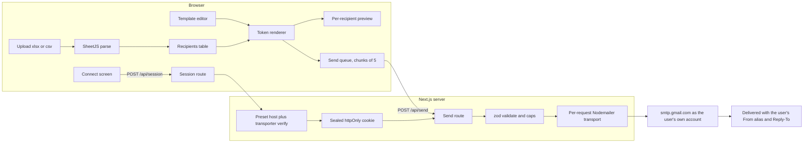

# Email Merger: end-to-end plan

## Product decision: bring your own app password

Each user connects their own Google mailbox with their own app password. The app is not tied to one inbox.

- **Quota, sender identity and replies are per user.** Each account has its own daily limit. The From alias comes from that user's own verified Send-as addresses, and Reply-To is theirs to set.
- **The app holds no secrets of its own.** `.env` contains only `SESSION_SECRET` (and optional access settings). Nothing is stored in a database in v1.
- **Credentials exist only in a sealed, httpOnly session cookie** that expires when idle. They are never written to disk, a database or logs.
- **Optional solo shortcut:** if `SMTP_USER` and `SMTP_APP_PASSWORD` are set in `.env.local`, the app can offer "Use local default account". It is disabled when `NODE_ENV=production`.
- **Later upgrade path:** "Sign in with Google" using the Gmail API and the `gmail.send` scope would remove password handling entirely. The tradeoff is Google sensitive-scope verification beyond 100 users, plus a privacy policy. The transport seam keeps that swap contained.

## What the research confirmed

- **From address:** Gmail SMTP silently rewrites `From:` to the authenticated account unless the address is a verified Send-as alias or Workspace alias in that same account ([Nodemailer: Using Gmail](https://nodemailer.com/guides/using-gmail)). SMTP never reports whether the alias is verified, so the Connect flow must include a real test email.
- **Your own setup:** `team@mybedigital.com` is a Workspace account with `team@resumestart.ai` as a verified alias, which is what makes `from: "ResumeStart Team <team@resumestart.ai>"` work. DNS for `resumestart.ai` shows Google MX records and SPF `include:_spf.google.com`, so that domain is Google-hosted. I found no DMARC TXT record, so rejection is unlikely, but alignment is not perfect.
- **Quota:** alias sends count against the same account limit and rotating aliases adds nothing. Workspace is 2,000 messages/day and personal Gmail is 500 recipients/day ([Google Workspace sending limits](https://knowledge.workspace.google.com/admin/gmail/gmail-sending-limits-in-google-workspace)). The UI shows these as approximate hints, not enforced values.
- **App passwords on Workspace:** they require 2-Step Verification on the account. They are hidden when 2SV is security-key-only, when the admin enforces "Only security key", or when the account is in Advanced Protection ([Deploy 2-Step Verification](https://knowledge.workspace.google.com/admin/security/deploy-2-step-verification)). Google also states that since May 2025 plain-password sign-in for third-party apps is unsupported on Workspace and recommends OAuth or SMTP relay ([Google Workspace Help](https://knowledge.workspace.google.com/admin/gmail/send-email-from-a-printer-scanner-or-app)). App passwords still work when allowed, but could be tightened later.
- **Fallback if Gmail rewrites or blocks:** `smtp-relay.gmail.com` can send as any domain address, up to 10,000/day, and Nodemailer has a built-in `GmailWorkspace` service for it ([Google SMTP relay docs](https://support.google.com/a/answer/2956491)). It needs admin-side setup, so it is a later preset, not v1.
- **Sending as a third-party address from Gmail** ends in January 2027 ([Gmail Help](https://support.google.com/mail/answer/17101213)). Google-hosted aliases and Workspace aliases are not affected, so your `resumestart.ai` alias should be fine. Using `ahanaf.tanvir40@gmail.com` as the sender with `team@resumestart.ai` as Send-as is the riskiest path: Google may restrict new configurations in Q3-Q4 2026, and personal Gmail is capped at 500/day.
- **Replies:** a reply goes to Reply-To if set, otherwise From. The app always sets Reply-To (defaulting to the From address), so replies reach the intended mailbox even if Gmail rewrites From.
- **Vercel:** on Hobby, route handlers can run up to 300 seconds, as default and maximum ([Vercel limits](https://vercel.com/docs/functions/limitations)). A chunk of 5 emails fits easily. The Hobby plan is, as far as I recall, for personal non-commercial use. I have not re-checked this today. If this becomes a product for other people, re-check Vercel's terms, or self-host.
- **Excel library:** npm's `xlsx` is stuck at 0.18.5, which has two CVEs (prototype pollution and ReDoS). The fixed SheetJS 0.20.3 is published only on its CDN ([SheetJS install docs](https://docs.sheetjs.com/docs/getting-started/installation/nodejs/)). I will vendor that tarball in `vendor/`. This also avoids your machine's private CodeArtifact npm registry, which returned 403 for `next`, `xlsx`, `nodemailer` and `zod` in my sandbox. Scaffolding will use `--registry https://registry.npmjs.org`.

## Architecture



The spreadsheet is parsed in the browser and never uploaded. The server receives only already-rendered emails, so it holds no merge logic and no recipient history.

## Project structure

```
Email-merger/
  vendor/xlsx-0.20.3.tgz
  .env.example            # never commit .env.local
  src/
    app/
      layout.tsx  page.tsx  globals.css
      api/session/route.ts          # POST connect, GET status (no secrets), DELETE disconnect
      api/send/route.ts             # POST: send a chunk
      api/test-send/route.ts        # POST: send one test email to the connected account
    proxy.ts (or middleware.ts)     # name per installed Next version; requires session on /api/send
    features/merge/
      components/                   # ConnectPanel, UploadStep, RecipientsTable, TemplateEditor,
                                    # TokenPalette, PreviewPane, SendPanel, StatusBar
      hooks/                        # useSession, useSendQueue
      store.ts                      # zustand: file, rows, template, selection, run state (no secrets)
    lib/
      spreadsheet/                  # parse.ts, headers.ts, emailColumn.ts
      merge/                        # tokens.ts, render.ts, escape.ts, derive.ts
      mail/
        providers.ts                # allow-listed presets (host, port, secure, quota hint)
        transport.ts                # createTransport(creds, preset), the single seam
        send.ts  errors.ts  htmlToText.ts
      session/
        seal.ts                     # iron-session config, idle expiry, redact helpers
      validation/schemas.ts         # zod contracts shared by client and server
      rateLimit.ts                  # in-memory, per IP
      env.ts                        # typed, validated env
    components/ui/                  # Button, Input, Table, Badge, Tabs, Toast, Skeleton
  tests/                            # vitest for lib/*
```

`lib/*` stays framework-agnostic and unit-tested. Features depend on `lib`, never the reverse. Send results flow through one hook (`useSendQueue`), so adding a DB later means one new persistence call there plus one table for campaigns and recipients. Credentials are never part of that persistence.

## Connect and session design

**Connect fields:** provider preset, account email (SMTP username), app password, display name, From address (defaults to the account email) and Reply-To (defaults to From).

**Flow**
1. `POST /api/session` validates input with zod, resolves host and port from the preset (the client never sends a host), and builds a transporter.
2. It runs `transporter.verify()`. On failure it returns a mapped message (see below) and sets no cookie.
3. On success it seals `{ user, pass, fromName, fromAddress, replyTo, preset }` into an `iron-session` cookie (httpOnly, Secure outside localhost, SameSite=Lax, about 2 hours idle expiry) and returns only the non-secret profile.
4. `GET /api/session` returns the profile, expiry and quota hint for the status bar. `DELETE` clears the cookie.
5. The UI then offers **Send test to me**, which sends a real message from the chosen From alias to the account email and tells the user to check the From line. This is the only reliable alias check.

**Handling credentials**
- The password is never written to disk, a database or logs. It is not echoed back and never appears in client state, URLs or error bodies.
- A central `redact()` is used by all logging and error paths. API routes send `Cache-Control: no-store`.
- Anyone who steals the cookie can use it until it expires, so the expiry is short and httpOnly protects against script access. The Connect screen has a visible Disconnect button.
- No analytics or error tracker may capture request bodies of `/api/session`.

**Provider presets (v1)**
- `gmail` covers Gmail and Google Workspace: `smtp.gmail.com`, port 465 (secure), with 587 STARTTLS as fallback.
- Hosts are allow-listed. There is no free-text SMTP host in v1. This prevents SSRF, internal port probing and the app being used as a general relay. Adding Outlook, Zoho or Brevo later means adding a preset entry.
- The quota hint is approximate: `gmail.com` or `googlemail.com` accounts show about 500/day and others about 2,000/day.

**Error mapping (shown with a fix)**
- `535`, auth failed: "App password rejected. Check it was copied without spaces, is not revoked, and belongs to this account."
- No App passwords option: "Turn on 2-Step Verification. If it is already on, your admin may enforce security keys only, or the account may be in Advanced Protection."
- `550 5.4.5`: "Daily limit reached. The run is stopped. Quota resets on a rolling 24 hours."
- Connection or timeout errors: "Could not reach Google's mail server. Try again."
- Unverified alias: not detectable over SMTP, so the test email and the status-bar warning cover it.

## Core behavior

**Tokens (`@firstname`, Gmail style)**
- Header normalization: lowercase, strip non-alphanumerics, so `First Name`, `first_name` and `FIRSTNAME` all resolve to `@firstname`.
- Regex `(?<![\w.])@([A-Za-z]\w*)`, so `john@gmail.com` is never touched. A token is replaced only if it matches a column.
- Derived fields: if there is a `Name` or `Full name` column and no `firstname`, derive `@firstname` and `@lastname`.
- Per-column fallback ("there" for missing first names), set in the UI, not as new syntax.
- Unknown tokens (typos like `@frstname`) are flagged with a "did you mean `@firstname`?" suggestion and block sending until resolved or ignored.
- Safety: cell values are HTML-escaped when substituted into the body, and CR/LF are stripped from the subject and from the display name (header injection). The plain-text alternative is generated from the HTML.

**Spreadsheet**
- Accepts `.xlsx`, `.xls`, `.csv`, with a sheet picker and a header-row check.
- The Email column is auto-detected by header name or content, with a manual override.
- Rows are flagged for invalid email, duplicate and empty, and each row can be excluded. Dates and numbers are formatted as displayed in Excel.
- A "Download sample file" link teaches the format. File size and row count are capped.

**Sending**
- The client queue posts chunks of 5. The server sends them sequentially with a 1.0 to 2.5 s jittered delay.
- The server builds a short-lived transport per request from the session cookie. Serverless instances can't be relied on to share a pool, and 5 messages per connection is cheap. The connection is closed at the end of each request.
- From, Reply-To and display name come from the session, never from the request body. The request carries only `to`, `subject`, `html` and `rowId`. Gmail enforces what From is actually allowed.
- Hard caps: max 10 messages per request and max `MAX_RECIPIENTS_PER_RUN` per run (default 100). Both show clear messages.
- A single bad recipient is marked failed without stopping the run. A fatal error (auth failure or daily limit) stops the run and keeps the remaining rows pending.
- Controls: pause, cancel, retry failed, "Send test to me" (renders row 1), and download a results CSV.
- Preflight checklist: connected as X, sending as Y, replies go to Z, N recipients, unresolved tokens, empty values, and the approximate quota hint.
- `beforeunload` guard during a run.

**Security**
- The send endpoint requires a valid sealed session. With no session it returns 401.
- Optional `ACCESS_CODE` env: when set, `POST /api/session` also requires that code, so strangers can't use a public deployment to test mailbox credentials. Leave it unset when running locally.
- Per-IP rate limiting on `/api/session` (for example 5 per 10 minutes) and `/api/send`. An in-memory limiter is weak on serverless, so it is a best-effort first layer. A free Upstash Redis limiter is the upgrade if the app is deployed publicly.
- Recipient addresses are validated server-side too, and max body size is enforced.
- Nothing secret is bundled to the client. Only `SESSION_SECRET` (32+ chars) is required in env.

**Env vars:** `SESSION_SECRET` (required), `ACCESS_CODE` (optional), `MAX_RECIPIENTS_PER_RUN`, `SEND_DELAY_MS`, and dev-only `SMTP_USER`, `SMTP_APP_PASSWORD`, `MAIL_FROM_ADDRESS`, `MAIL_FROM_NAME`, `MAIL_REPLY_TO` for the local default account.

## UI and design (Impeccable)

Mode is **Operate**: a person completes a task repeatedly, so scanability and trust beat expression. Because the app asks for a mailbox credential, trust and clarity on the Connect step matter as much as the merge screens.

- **Process at build time:** run `impeccable context`, then `init` to write PRODUCT.md (it is missing). This is a new visual world, so the skill requires its direction roll before any UI code, then the `craft-floor.md` checks while building. After the build there is one batched desktop and mobile inspection round, one `impeccable detect` pass, the finish reviewer, and DESIGN.md. I'll bring the direction choice to you rather than pinning it myself.
- **Constraints already pinned:** restrained color (neutrals plus one action color), and a light surface because it is used at a desk in daylight. The type is a workhorse sans, not on the skill's banned list, with tabular numerals for data. Token chips use one consistent highlight, status colors (pending, sent, failed) are semantic only, and the focus ring is visible everywhere. No icon-card grids, no eyebrow labels, no modals, no gradients or glass, no emoji as icons (drawn icons from one library). Browser defaults such as selection color, caret, scrollbars and focus ring are themed.
- **Layout:** one persistent workspace, not a locked wizard. A top progress strip (Connect, Recipients, Compose, Review and send) lets you move freely once connected. A sticky status bar always shows "Connected as X, sending as Y, N ready" with the primary action and a Disconnect control.
- **Connect screen:** a plain form beside a short numbered setup guide (turn on 2-Step Verification, create an app password, paste it). Copy states plainly that an app password gives access to the whole mailbox, suggests a dedicated sender mailbox, says the app stores nothing and that the session ends after inactivity, and links to where the user can revoke it. Failures show the mapped message with the fix, inline, not in a modal.
- **Compose:** TipTap (MIT) editor holding plain `@field` text, so templates pasted from Gmail work. Valid tokens are highlighted and unknown ones are underlined. Typing `@` opens autocomplete, and a side palette lists columns with a sample value you click to insert. There is also an HTML-source toggle for pasted templates.
- **Preview:** a Gmail-like message frame with From, Reply-To, To and Subject. Prev/next and search move between recipients. Substituted values can be highlighted, and empty fields are flagged.
- **Send:** an inline confirm bar (not a modal), a live `aria-live` progress bar, per-row status chips, and a retry-failed action.
- **States:** every control has hover, focus, active, disabled, loading and error. There are skeletons for loading, empty states that teach (drop zone with sample file), reduced-motion support, and keyboard-complete flows. The password field has a show/hide control and `autocomplete="off"`. The layout is desktop-first and collapses structurally to a single column on small screens.

## Build phases

1. **Smoke test (before UI):** scaffold, install Nodemailer, and run a script with a real app password. First send one email as `team@resumestart.ai` from `team@mybedigital.com`, and in Gmail's "Show original" check that From held, that Reply-To is set, and look at SPF, DKIM and DMARC. Then repeat with a personal Gmail account to compare. If From is rewritten or auth fails, decide on the relay or OAuth2 preset before continuing.
2. **Scaffold:** `create-next-app` (latest, App Router, TS, Tailwind, ESLint, `src/`), `git init`, folders above, `env.ts`, `.env.example`, Vitest.
3. **Core libs with tests:** header normalization, token parse/render/escape, derived fields, email detection and validation, plain-text conversion, error mapping, `redact()`.
4. **Connect and session:** presets, sealed cookie, `/api/session`, rate limit, optional access code, tests with a mocked transport.
5. **Server send:** `/api/send`, `/api/test-send`, caps, jitter, fatal-versus-row error handling.
6. **Design:** `init`, direction roll, and tokens in `globals.css`.
7. **UI features in order:** Connect screen and status bar, upload and table, editor and palette, preview, send panel and queue.
8. **Hardening:** edge cases (BOM CSVs, duplicate headers, merged cells, 0 rows, huge files with a size cap), a11y pass, empty and error states, a pass over log output to confirm the password never appears.
9. **Verify:** unit tests, lint and typecheck, a real end-to-end send of 3 to 5 rows from two different accounts to your own addresses, one batched desktop plus mobile screenshot round, detector, finish review, DESIGN.md.

## Out of scope for v1 (seams left)

DB history and campaigns (you plan to add Supabase or Neon later, metadata only, never credentials), Google OAuth sign-in, custom SMTP hosts and extra provider presets, SMTP relay, attachments, open and click tracking, unsubscribe management, and saved sender identities.

## What I need from you at build time

A sample `.xlsx` and your real template, to test against real headers. Confirm that 2-Step Verification is on for `team@mybedigital.com` and that its admin policy allows app passwords, so one can be created for the smoke test. It would also help to know whether `team@resumestart.ai` is a real mailbox or only an alias, to confirm where replies land.
